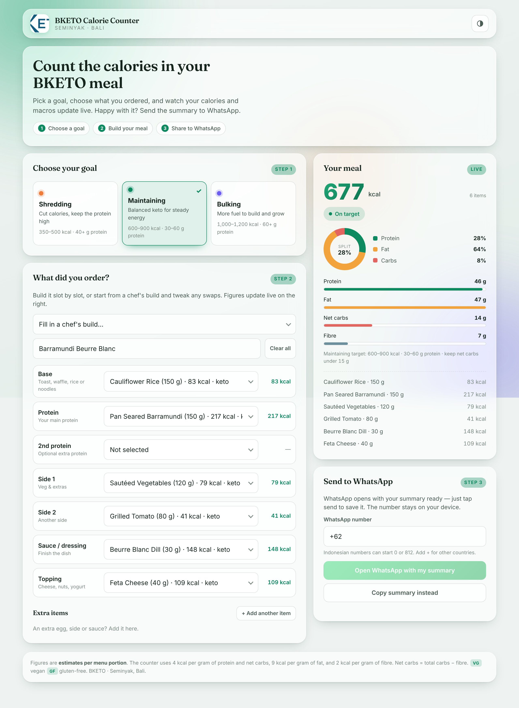

# BKETO Calorie Counter

A clean, glassy web app that lets guests estimate the calories and macros in
their **BKETO** meal (Seminyak, Bali), check them against a goal, and send a
summary to WhatsApp.

Rebuilt from the original single‑file prototype into a proper, hostable
**React + Vite** app with a responsive dashboard‑style UI and light/dark themes.



---

## What it does

1. **Choose a goal** — Shredding, Maintaining, or Bulking (each has calorie &
   protein targets and a keto net‑carb limit).
2. **Build the meal** — pick items slot by slot (Base, Protein, 2nd protein,
   Side 1, Side 2, Sauce/dressing, Topping), add extras, or auto‑fill from one
   of 30 chef builds and tweak swaps.
3. **See it live** — total calories, a protein/fat/carb split donut, macro
   bars, goal status, and an itemised list all update instantly.
4. **Share to WhatsApp** — opens WhatsApp with a ready‑to‑send text summary, or
   copies it to the clipboard. The phone number never leaves the device.

The calorie model matches the original tool exactly: **4 kcal/g** protein and
net carbs, **9 kcal/g** fat, **2 kcal/g** fibre, with net carbs = carbs − fibre.

## Tech stack

- **React 18** + **Vite 5** — a fast, dependency‑light single‑page app.
- Plain modern CSS (glassmorphism, CSS variables, light/dark). No UI framework.
- 100% client‑side — **no backend or database required**, so it hosts anywhere
  that can serve static files.

## Project structure

```
src/
  data/menu.js        All menu items, chef builds, goals, and meal slots
  lib/calc.js         Calorie/macro math + WhatsApp summary (pure functions)
  hooks/useTheme.js   Light / dark / system theme
  components/         Header, GoalSelector, MealBuilder, SummaryPanel, …
  styles/             index.css (tokens + background) and components.css
  App.jsx             App state wiring everything together
public/logo.png       BKETO logo (also the favicon)
```

To change the menu, edit **`src/data/menu.js`** only — every number on screen
and in the WhatsApp summary comes from there.

## Run it locally

Requires [Node.js](https://nodejs.org/) 18+.

```bash
npm install      # install dependencies (first time only)
npm run dev      # start the dev server at http://localhost:5173
```

## Build for production

```bash
npm run build    # outputs a static site into dist/
npm run preview  # optional: preview the production build locally
```

The `dist/` folder is the whole site — plain HTML, CSS, JS and the logo.

## Deploy to your hosting

The build uses a **relative base path**, so it works from a domain root *or* a
sub‑folder (e.g. `yoursite.com/calories/`).

**Shared hosting / cPanel (e.g. upload via File Manager or FTP)**
1. Run `npm run build`.
2. Upload **the contents of `dist/`** into your `public_html` (or a sub‑folder
   like `public_html/calories/`).
3. Done — visit the URL. It's a static site, so no Node.js is needed on the
   server.

**Netlify / Vercel / Cloudflare Pages**
- Build command: `npm run build`
- Publish/output directory: `dist`

**Nginx / Apache**
- Serve the `dist/` folder as static files. Because it's a single page with no
  client‑side routing, no rewrite rules are needed.

## Notes

- Figures are **estimates per menu portion** and are for guidance only.
- Theme preference is remembered per browser; nothing else is stored or sent.
- Fonts load from Google Fonts with system‑font fallbacks, so the app still
  looks right offline or if that request is blocked.
